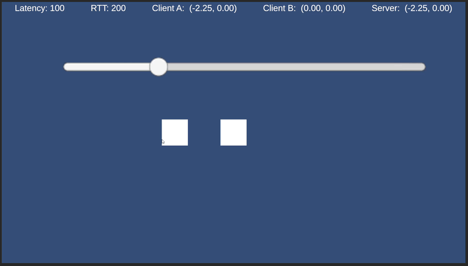
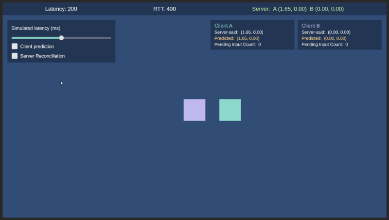

# Server-Authoritative Netcode Prototype (Unity)

A minimal server-authoritative multiplayer prototype built from scratch in Unity, with no networking framework. One server and two clients run inside a single scene, connected by message queues with artificial latency, in the spirit of Gabriel Gambetta's *Fast-Paced Multiplayer* demo.

The goal is to implement and be able to explain, from first principles, the core techniques behind responsive networked gameplay: **client-side prediction**, **server reconciliation** and **entity interpolation**.

**Weeks 1 and 2 of 3 are done.** Week 1 is the pure authoritative model, intentionally laggy so the problem is visible and measurable. Week 2 adds client-side prediction and server reconciliation, which remove that lag for the local player without giving up server authority. Week 3 will add interpolation of the remote player.

## What it does

- One `Server` and two `Client`s live in the same scene and only talk through `LagQueue<T>`, a message queue that delivers each message after a configurable delay.
- Clients send **numbered intentions** (`InputMessage`), never positions. The server simulates at a fixed tick and publishes the authoritative state (`StateMessage`) to every client, including the last input it processed from each one.
- Each client predicts its own movement locally and reconciles it against every snapshot. The remote player is drawn from the latest snapshot received.
- A latency slider changes the delay live; two toggles switch prediction and reconciliation on and off; a HUD shows the server's position, each client's predicted and server-confirmed positions, and how many inputs are in flight.





## How to run

- Unity 6000.3.14f1.
- Open `Assets/Scenes/TestScene`, press Play.
- **WASD** moves client A, **arrow keys** move client B. The slider sets one-way latency in ms; the toggles enable prediction and reconciliation for both clients.
- Tests: `Window → General → Test Runner → EditMode`. 19 tests cover `LagQueue`, `Server`, `Client` and `Movement` without opening a scene.

## Architecture

```
Client A ──InputMessage──► LagQueue ──► Server ──StateMessage──► LagQueue ──► Client A
Client B ──InputMessage──► LagQueue ──►        ──StateMessage──► LagQueue ──► Client B

Server tick (every 50 ms):  Drain  →  Simulate  →  Publish
Client tick (every 50 ms):  Send + Predict  →  Receive  →  Reconcile
```

- **`LagQueue<T>`** — a FIFO of `(deliveryTime, message)`. `Send` stamps `now + latency`; `TryReceive` only looks at the front and delivers it when its time has come. O(1), no allocations, testable with a fake clock.
- **`Movement`** — one static, pure function: `position + direction * speed * dt`. The only place movement is computed, used by both server and client.
- **`Server`** — owns the only authoritative state. `Drain` empties every input queue, discards inputs with a stale sequence number and keeps the direction received this tick; `Simulate` calls `Movement`; `Publish` sends the same snapshot to every client, including `lastProcessedSequence` per client and the server tick. `Simulate` knows nothing about the network, and `Server` knows nothing about prediction.
- **`Client`** — sends numbered inputs, applies them locally at once (prediction), keeps the unconfirmed ones in a buffer, and on each snapshot accepts the server's position and replays the unconfirmed inputs (reconciliation). Draws the remote player from the latest snapshot.
- **`Orchestrator`** — the only `MonoBehaviour`. Owns the clock (integer ms), runs the ticks, reads the keyboard, wires the UI and draws the cubes. No networking logic lives here.

## Week 1: the authoritative server

Clients only send intentions. The server moves everything and tells everyone where it is. Each client draws what it has received, so with 100 ms per leg a key press takes ~200 ms to show on screen.

### Measurements

Press-to-screen delay for client A, measured in the Editor with the frame rate uncapped (~600 fps), tick 50 ms:

| One-way latency | Measured | Expected (`2 × latency + 0..tick`) |
|---|---|---|
| 0 ms | 62–92 ms | 50–100 ms |
| 100 ms | 199–244 ms | 200–250 ms |
| 400 ms | 804–848 ms | 800–850 ms |

The `0..tick` term is the wait until the next tick after the key press. At zero latency there is still a full tick of delay: the client drains its queue before the server publishes in the same tick, so the snapshot is seen one tick later. With real latency that cost disappears because the snapshot is already due when the client ticks.

The last row was first measured with the slider believed to be at 300 ms and came out ~200 ms above the prediction. Working the formula backwards pointed at 400 ms, which was the slider's actual value: the model found the bug in the measurement.

## Week 2: client-side prediction and server reconciliation

Week 1 was correct but unplayable. Week 2 removes the round-trip delay for the player's own character without giving up server authority.

**Client-side prediction.** The client no longer waits. When it sends an input, it also applies it locally, immediately, using the *same* `Movement.GetNewPosition` the server uses. It is not guessing what the server will do; it is computing it ahead of time.

**Server reconciliation.** Every input carries a sequence number, and every snapshot carries the last sequence number the server processed for each client. When a snapshot arrives, the client (1) takes the server's position as the truth up to that sequence number, (2) drops the pending inputs the server has already seen, and (3) re-applies the pending inputs the server has not seen yet, in order. If the server agreed with the prediction, the result is bit-for-bit the position the client already had, so nothing moves. If the server disagreed (a collision, a push), the correction is applied *and* the player's later inputs are preserved on top of it: a small adjustment instead of a teleport.

Both techniques live entirely in `Client.Tick`. `Server` did not change between Week 1 and Week 2 except for one thing: it now includes `lastProcessedSequence` per client in every snapshot. The server never knows that clients predict.

```
client has sent:   #5  #6  #7  #8  #9          (all applied locally already)
snapshot arrives:  position P, lastProcessed = 6

reconcile:  predicted = P                 accept the truth up to #6
            drop #5, #6                   already confirmed
            replay #7, #8, #9             what the server has not seen
```

### Why prediction alone does nothing here

In Gambetta's article, prediction without reconciliation produces a visible stutter: the player jumps back every time a snapshot arrives. In this prototype it produces nothing at all. The server publishes a snapshot every tick, so after the first round-trip a snapshot arrives *every* client tick. Each tick the client predicts one step forward and the snapshot immediately overwrites it. The prediction never survives long enough to be seen; the measured delay is identical to Week 1 (see table). Reconciliation is not a refinement of prediction; without it, prediction is simply erased.

### Measurements

Press-to-screen delay for client A, Editor, frame rate uncapped (~600 fps), tick 50 ms:

| Mode | 100 ms one-way | 400 ms one-way | Formula |
|---|---|---|---|
| Prediction off | 202–238 ms | 832–845 ms | `2 × latency + (0..tick)` |
| Prediction on, reconciliation off | 196–227 ms | 803–830 ms | same (prediction is erased each tick) |
| Prediction on, reconciliation on | 0–42 ms | 26–38 ms | `0..tick`, independent of latency |

Pending (unconfirmed) inputs with prediction and reconciliation on, at 0 / 100 / 200 / 400 ms one-way: **1 / 4 / 8 / 16**, i.e. `RTT / tick`. That number is how many ticks of the future the client is predicting at any moment.

Note the last row: prediction removes the *network* latency but not the *tick* latency. Inputs are sampled and predicted inside `Client.Tick`, every 50 ms, so a key pressed just after a tick waits up to 50 ms. Production games sample input and predict at frame rate, or visually interpolate the local character between ticks. Left as a known limitation.

## Design decisions

- **Time is integer milliseconds.** Avoids float drift in delivery times and makes tests exact.
- **The channel preserves order.** `TryReceive` only inspects the front of the queue, so a message cannot overtake an older one. If latency is lowered mid-game, new messages wait behind old ones and arrive later than configured. Real UDP gives no such guarantee; sequence numbers (Week 2) make reordering detectable, although the simulated channel never reorders.
- **Messages and state are `struct`s.** A snapshot in flight must never share memory with the server's live state; passing a `struct` through `Send` copies it, so a later tick cannot alter a message that has not arrived yet. With real serialization this problem disappears on its own; it exists precisely because the network is simulated in memory.
- **Server state is private.** The outside world gets a read-only copy. Nothing but `Simulate` can write a position; that is what "authoritative" means in code.
- **Fixed tick, not per-message.** Same `dt` every time makes the simulation deterministic: the same inputs always produce the same positions. That property is what lets a client re-simulate the server's work. The cost is up to one tick of extra latency.
- **Multiple inputs in one tick: last one wins.** See the known mismatch below.
- **An input whose `clientId` does not match the queue it arrived on is ignored and logged.** The server never trusts a message to say who sent it.
- **Clients tick before the server.** A message sent this tick is processed this tick; with zero latency the reverse order would add one tick.
- **Ticks use `nextTickMs`, not the real clock.** Every tick happens at an exact multiple of 50 ms regardless of frame rate, so delivery times are regular and a long frame can run several ticks correctly.
- **One shared movement function (`Movement`).** The client and the server must simulate *identically*, and "the same formula" is not enough: floating-point multiplication is not associative, so `direction * speed * dt` and `direction * (speed * dt)` can differ in the last bit. Accumulated 20 times a second that becomes a micro-correction on every snapshot. Sharing the code, not the formula, is what makes reconciliation produce zero visible correction.
- **Sequence numbers and a cumulative ack.** The server does not acknowledge inputs one by one; it reports the highest sequence it has processed. One integer covers any number of inputs in flight, costs nothing to track on the server, and tolerates lost snapshots (the next one carries a higher number). Inputs with a sequence lower than or equal to the last processed one are ignored, which also neutralises duplicate or replayed inputs.
- **`-1` means "nothing processed yet".** With the first input numbered 0, initialising `lastProcessedSequence` to 0 would silently discard every client's first input as a duplicate. The existing Week 1 test caught it.
- **Pruning uses `<=`, not `<`.** The snapshot's position already includes the input numbered `lastProcessed`. Re-applying it would leave the client one step ahead of the server forever, invisibly.
- **Pending inputs live in a `List`.** Chosen for clarity. In production this would be a fixed-size circular buffer with a power-of-two size (e.g. 1024): bounded memory, zero allocations after start-up, O(1) lookup by `sequence & (size - 1)`, and 1024 ticks is far more than any round-trip worth staying connected for.
- **Reconcile only against the last snapshot of the tick.** If two arrive in one tick, the later one carries a higher `lastProcessed` and subsumes the earlier one.
- **Reconciliation does not touch the server.** `Server` is unaware of prediction; it only reports what it processed. Keeping all reconciliation state on the client is what keeps the server cheap and simple.
- **Known mismatch: "last input wins" under jitter.** The server applies at most one input per tick per client; if two of a client's inputs ever land in the same server tick, the server moves once while the client replays twice. It cannot happen with constant latency and one input per tick, but it would with jitter. The real fix is to stamp each input with its tick and have the server simulate one tick per input.

## Known limitations / Next

- The remote player still moves in 50 ms steps: no interpolation yet.
- Prediction runs at tick rate, not frame rate (up to one tick of input delay remains).
- No packet loss, reordering or jitter; the simulated channel is perfectly ordered.
- No physics or collisions, so the server never actually disagrees with the client outside of tests.
- Pending-input buffer is unbounded (a `List`); see design decisions.

**Week 3** — interpolation of remote players; optional real UDP transport with LiteNetLib.

## References

- Gabriel Gambetta, *Fast-Paced Multiplayer, Part I: Client-Server Game Architecture* — https://gabrielgambetta.com/client-server-game-architecture.html
- Gabriel Gambetta, *Fast-Paced Multiplayer, Part II: Client-Side Prediction and Server Reconciliation* — https://gabrielgambetta.com/client-side-prediction-server-reconciliation.html
- Glenn Fiedler, *What Every Programmer Needs To Know About Game Networking* — https://gafferongames.com/categories/game-networking/
- Glenn Fiedler, *Reliability, Ordering and Congestion Avoidance over UDP* — https://new.gafferongames.com/post/reliability_ordering_and_congestion_avoidance_over_udp/
- Tom Weiland, *Riptide Multiplayer Tutorials*, Parts 1–2 — https://www.youtube.com/playlist?list=PLXkn83W0Qkfn3qF7NU4OEtVwOD6U2wphJ
- git-amend, *Unity Netcode 100% Server Authoritative with Client Prediction and Reconciliation* — https://www.youtube.com/watch?v=-lGsuCEWkM0
- Ajackster, *How To Do Client Prediction* — https://www.youtube.com/watch?v=TFLD9HWOc2k
